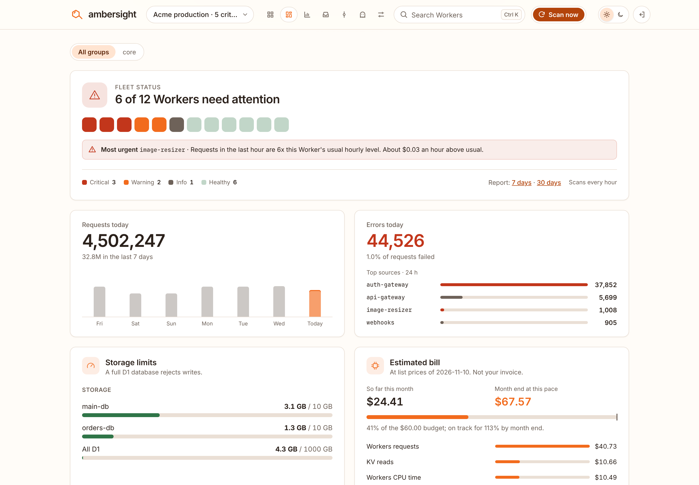
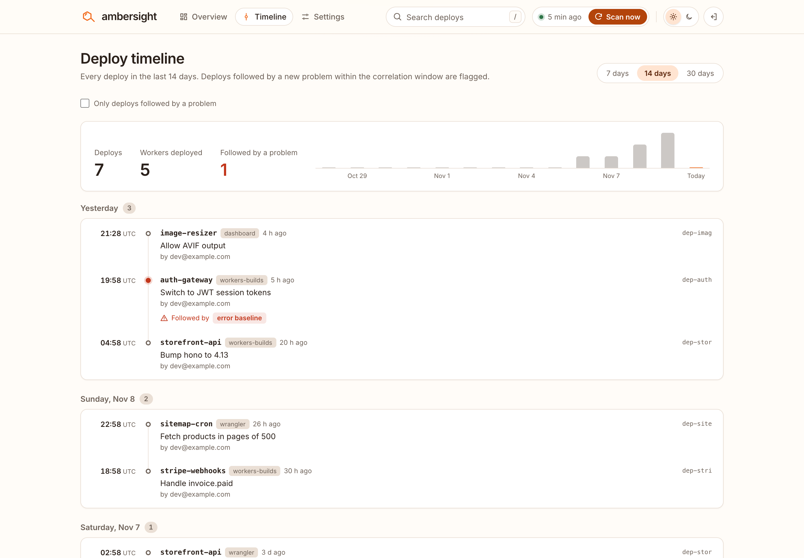
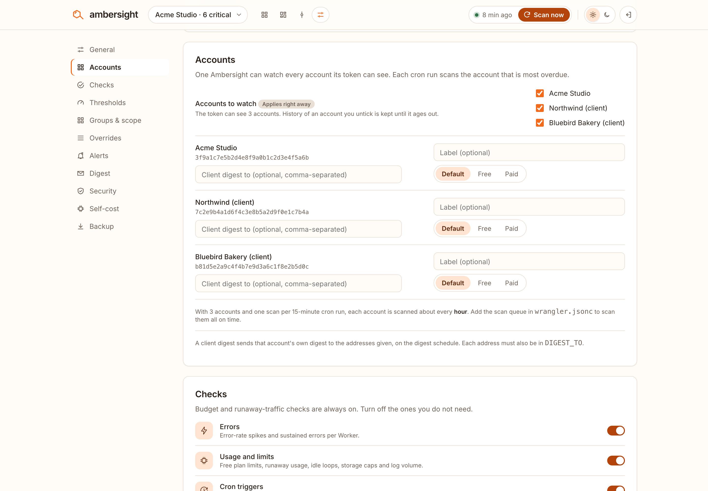
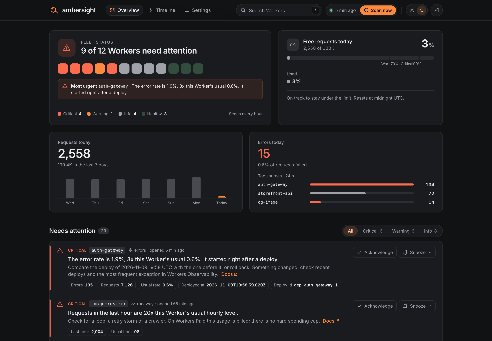
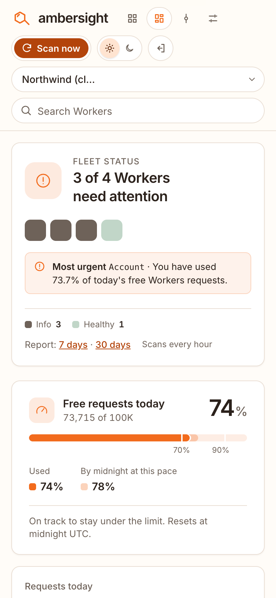

<p align="center">
  
</p>

<h1 align="center">ambersight</h1>

<p align="center"><strong>Your whole Cloudflare Workers fleet on one page.</strong><br>Read-only. Free. No code changes.</p>

<p align="center">
  <a href="https://deploy.workers.cloudflare.com/?url=https://github.com/jntegz/ambersight"></a>
</p>

<p align="center">
  <a href="LICENSE"></a>
  
  
</p>

<picture>
  <source media="(prefers-color-scheme: dark)" srcset="docs/screenshots/overview-dark.png">
  
</picture>

---

You have a dozen Workers, maybe fifty. One is quietly burning through the free plan's 100,000 daily requests. A cron job stopped running on Tuesday. A deploy last night doubled an error rate. An old Worker still answers on a public `workers.dev` address nobody remembers.

The Cloudflare dashboard shows you each Worker on its own. **Ambersight shows you the fleet** and tells you which Workers need attention, and why, in plain sentences.

It runs as **one Worker in your own Cloudflare account**. Every hour it reads your Workers' settings and metrics with a read-only API token, runs a set of checks, and gives you a ranked list of what to fix. Alerts go to e-mail, Slack, Discord, Telegram or any webhook.

## What it catches

| | Ambersight tells you when… |
| --- | --- |
| **Free plan budget** | you are on track to hit today's 100,000-request limit (Error 1027), and roughly when. |
| **Runaway usage** | requests, CPU time, subrequests, D1, KV, R2, Queues or Durable Objects jump to 5x their usual hourly level. On Workers Paid there is no spending cap, so this is the alert that saves money. |
| **Errors and limits** | error rates pass 2% or 10%, or triple a Worker's own baseline; invocations hit CPU or memory limits; p99 CPU gets close to the free plan's 10 ms. |
| **Cron health** | scheduled runs are missed or fail, a cron gets close to its CPU limit, or you are running out of Cron Triggers. |
| **Bad deploys** | a problem starts right after a deploy. The timeline marks the deploy and the finding names it. |
| **Deprecations** | a Worker still uses Service Worker syntax, an old compatibility date, the legacy usage model, Workers Sites or redundant flags. |
| **Exposure** | preview URLs are public, a forgotten `workers.dev` hostname still answers, or (optional) a URL is not behind Cloudflare Access. |
| **Zombies and orphans** | Workers with no traffic or never deployed; KV, D1, R2 and Queues bound to nothing; routes and service bindings that point at deleted Workers. |

Every finding comes with the evidence, a suggested fix and a link to the Cloudflare docs. Findings from the same check are grouped, so fourteen Workers with public preview URLs are one row with one fix, not fourteen. Critical and warning come first; info-level housekeeping stays folded away. Acknowledge or snooze one finding or a whole group, or stop a check you don't care about.

Also included: groups and tags, per-Worker thresholds, include and exclude rules, a weekly or daily digest in your time zone, quiet hours, and a **Self-cost** panel that shows exactly what Ambersight itself uses.

## Screenshots

<table>
  <tr>
    <td width="50%"><br><sub><b>Deploy timeline.</b> Every deploy across the fleet. The one followed by a new problem is flagged.</sub></td>
    <td width="50%"><br><sub><b>Settings.</b> Every check, threshold, schedule and alert route, stored in D1. Export and import as JSON.</sub></td>
  </tr>
  <tr>
    <td width="50%"><br><sub><b>Dark mode.</b> Follows your system, or pick one.</sub></td>
    <td width="50%" align="center"><br><sub><b>On your phone.</b> Check the fleet from anywhere.</sub></td>
  </tr>
</table>

<sub>Screenshots use a made-up demo fleet.</sub>

## Why you can trust it with your account

- **Read-only, by design.** It only sends `GET` requests and GraphQL queries to the Cloudflare API. The setup wizard checks your token and refuses to continue if it finds a single write permission.
- **Your account, your data.** It runs in your Cloudflare account and stores everything in your own D1 database. Nothing is sent to us. There is no telemetry and no analytics.
- **No code in your Workers.** No SDK, no tail consumer, no redeploy. It reads what Cloudflare already records.
- **Free to run.** With 30 Workers it uses well under 1% of the free plan's daily requests and 1 of your 5 Cron Triggers. Its own logs are off.
- **Open source.** AGPL-3.0. Read every line before you deploy it.

---

## Install

You need a Cloudflare account (the free plan is fine). Pick one way.

| | Best for | Time |
| --- | --- | --- |
| [**A. Deploy button**](#a-deploy-button) | Most people. No terminal. Updates deploy on every push to your copy. | 5 minutes |
| [**B. Terminal**](#b-terminal) | Developers who use Wrangler and want the config in their own repo. | 5 minutes |

Both start with the same step.

### Step 1: Create a read-only API token

[**Open the pre-filled token form**](https://dash.cloudflare.com/profile/api-tokens?permissionGroupKeys=%5B%7B%22key%22%3A%22workers_scripts%22%2C%22type%22%3A%22read%22%7D%2C%7B%22key%22%3A%22account_analytics%22%2C%22type%22%3A%22read%22%7D%2C%7B%22key%22%3A%22account_settings%22%2C%22type%22%3A%22read%22%7D%2C%7B%22key%22%3A%22workers_kv_storage%22%2C%22type%22%3A%22read%22%7D%2C%7B%22key%22%3A%22d1%22%2C%22type%22%3A%22read%22%7D%2C%7B%22key%22%3A%22workers_r2%22%2C%22type%22%3A%22read%22%7D%2C%7B%22key%22%3A%22queues%22%2C%22type%22%3A%22read%22%7D%2C%7B%22key%22%3A%22zone%22%2C%22type%22%3A%22read%22%7D%2C%7B%22key%22%3A%22workers_routes%22%2C%22type%22%3A%22read%22%7D%2C%7B%22key%22%3A%22billing%22%2C%22type%22%3A%22read%22%7D%2C%7B%22key%22%3A%22access%22%2C%22type%22%3A%22read%22%7D%2C%7B%22key%22%3A%22api_tokens%22%2C%22type%22%3A%22read%22%7D%5D&accountId=*&zoneId=all&name=Ambersight%20read-only). Check that every permission says **Read**, click **Continue to summary**, then **Create Token**. Copy the token now; Cloudflare shows it only once.

The form opens with the token set to **All accounts** and **All zones**. If you belong to several Cloudflare accounts, the setup wizard asks which one to watch. You can also narrow the token to that account before you create it.

<details>
<summary>Prefer to create the token by hand? These are the permissions.</summary>

**My Profile › API Tokens › Create Token › Custom token**, with only these permissions:

| Scope | Permission | Access | Needed for |
| --- | --- | --- | --- |
| Account | Workers Scripts | Read | **Required.** The list of Workers and their settings |
| Account | Account Analytics | Read | **Required.** Requests, errors, CPU, cron runs |
| Account | Account Settings | Read | Finding your account ID |
| Account | Workers KV Storage, D1, Workers R2 Storage, Queues | Read | Zombie and storage checks |
| Zone | Workers Routes, Zone | Read | Exposure checks and orphaned routes |
| Account | Billing | Read | Detecting Free or Paid automatically. Without it, Ambersight uses `PLAN` from `wrangler.jsonc`; you can also set the plan in **Settings › General**. |
| Account | Access: Apps and Policies | Read | The Access coverage check (off by default) |
| User | API Tokens | Read | Letting the setup wizard prove the token has no write scopes |

Do not add any **Edit** permission. If the token can see several accounts, the setup wizard lets you choose one. To fix the choice in config instead, set `CF_ACCOUNT_ID` in `wrangler.jsonc` under `vars`.
</details>

### A. Deploy button

1. Click **Deploy to Cloudflare**:

   [](https://deploy.workers.cloudflare.com/?url=https://github.com/jntegz/ambersight)

2. Sign in to Cloudflare and connect GitHub (or GitLab). Pick a name for your copy of the repository.
3. Fill in the two fields:

   | Field | What to enter |
   | --- | --- |
   | `CF_API_TOKEN` | The read-only token from step 1 |
   | `ADMIN_PASSPHRASE` | A passphrase of at least 12 characters. You sign in with it, so put it in your password manager. |

4. Click **Deploy**. Cloudflare copies the repository into your account, creates the D1 database, applies the migrations and deploys the Worker.
5. When it finishes, open the link on the deploy page (`https://ambersight.<your-subdomain>.workers.dev`), sign in, and follow the three setup steps. The first scan starts on its own and then runs every hour.

Your copy is connected to **Workers Builds**, so every commit you push to it deploys automatically. To change `wrangler.jsonc` (for example to turn on e-mail), edit the file on GitHub and commit.

### B. Terminal

You need Node.js 22.12 or newer and git.

```bash
git clone https://github.com/jntegz/ambersight.git
cd ambersight
npm install
npx wrangler login

# First deploy: builds the dashboard and creates the D1 database for you
npm run build
npx wrangler deploy

# Create the tables
npx wrangler d1 migrations apply DB --remote

# Add the two secrets (you will be asked to paste each value)
npx wrangler secret put CF_API_TOKEN
npx wrangler secret put ADMIN_PASSPHRASE
```

Wrangler prints your dashboard URL at the end of the deploy. Open it, sign in and follow the setup steps.

On the first deploy, Wrangler creates the `ambersight` D1 database and writes its ID into `wrangler.jsonc`. Commit that change if you keep your own repository. From then on, a single command builds, migrates and deploys:

```bash
npm run deploy
```

### Updating

Ambersight shows a notice in the dashboard when a new release is out (it asks GitHub for the latest release number and sends nothing about your account; you can turn this off in Settings).

- **Deploy button copy:** in your repository, add this one as a remote and merge the new version. Workers Builds deploys it.
  ```bash
  git remote add upstream https://github.com/jntegz/ambersight.git
  git pull upstream main
  git push
  ```
- **Terminal install:** `git pull`, then `npm install && npm run deploy`.

New database migrations are applied by the deploy script in both cases.

---

## Lock it down with Cloudflare Access

The dashboard has its own passphrase login: sessions are random 256-bit IDs (stored only as hashes), cookies are `__Host-` prefixed, `HttpOnly`, `Secure` and `SameSite=Strict`, and requests that do not come from the dashboard's own origin are refused. Five wrong attempts from one address lock that address out for 15 minutes. 50 wrong attempts from any mix of addresses pause sign-in for everyone for 15 minutes, so someone with many addresses can keep you from signing in (your open sessions keep working). Access in front, below, removes that. Changing the passphrase, rotating the `ADMIN_PASSPHRASE` secret or deleting the stored passphrase signs every session out. The `ADMIN_PASSPHRASE` secret must be at least 12 characters. That is a good lock. **Cloudflare Access is a better door**: nobody reaches the sign-in page at all unless they first prove who they are with your e-mail, Google, GitHub or another identity provider. Zero Trust is free for small teams.

Use both. It takes two minutes.

### Option 1: Protect the whole Worker (recommended)

This covers every way to reach Ambersight: the `workers.dev` address, custom domains and routes.

1. In the Cloudflare dashboard, go to **Workers & Pages** and open your **ambersight** Worker.
2. Open the **Access** tab and choose **Protect this Worker behind Access**.
3. Choose **All traffic** (not only previews) and click **Apply Access**.
4. Edit the policy so it allows only you: for example **Include › Emails ›** `you@example.com`. With the one-time PIN login method, Cloudflare e-mails you a code. No extra setup is needed.

Open your dashboard URL in a private window. You should see the Cloudflare Access login first, then the Ambersight passphrase.

### Option 2: Custom domain with a self-hosted application

If you serve Ambersight on your own hostname, for example `ambersight.example.com`:

1. Add the hostname under **Workers & Pages › ambersight › Settings › Domains & Routes › Add › Custom domain**.
2. In **Zero Trust › Access controls › Applications**, choose **Create new application › Self-hosted**, add that public hostname, and attach a policy that allows only your e-mail address or group.
3. **Turn off the `workers.dev` address**, or it stays a public way around Access. Set `"workers_dev": false` in `wrangler.jsonc`, commit it (for a Deploy-button copy, in your own repository) and deploy. Do not rely only on **Settings › Domains & Routes › workers.dev › Disable** in the dashboard: the next deploy applies `wrangler.jsonc` again and turns `workers.dev` back on.

Preview URLs are already off in Ambersight's config (`"preview_urls": false`), so there is no third way in.

> [!TIP]
> Once Access is on, turn on the **Cloudflare Access coverage** check in **Settings › Checks** (it needs the *Access: Apps and Policies Read* permission). Ambersight will then tell you which of your *other* Workers are public without Access.

---

## Alerts

### E-mail (free)

Ambersight uses Cloudflare's `send_email` binding. It is free when you send to a **verified address** in Email Routing; a Gmail address works.

1. Turn on **Email Routing** for a domain you have on Cloudflare and verify the address you want alerts at.
2. In `wrangler.jsonc`, set `EMAIL_FROM` (any address on that domain) and `DIGEST_TO` (your verified address), and uncomment the `send_email` block with the same address.
3. Commit (Deploy button) or run `npm run deploy` (terminal).

### Slack, Discord, Telegram, ntfy or any webhook

```bash
npx wrangler secret put WEBHOOK_URL
```

Paste a Slack or Discord incoming-webhook URL, a Telegram `https://api.telegram.org/bot<token>/sendMessage?chat_id=<id>` URL, an ntfy topic URL, or any HTTPS endpoint that accepts JSON. With the Deploy button you can also add it in the Cloudflare dashboard under **ambersight › Settings › Variables and Secrets**.

In **Settings › Alerts**, choose per severity whether alerts go to e-mail, the webhook, both or only the digest. Every channel has a **Send test** button.

## What it costs

Nothing, on the Workers Free plan. With 30 Workers:

- **Cron Triggers:** 1 of your 5. It fires every 15 minutes but only scans at the interval you choose (hourly by default); the other runs stop after one D1 read.
- **Requests:** about 100 cron runs plus a few hundred dashboard API calls a day. That is well under 1% of the 100,000 daily requests. Page views are static assets and do not count.
- **Subrequests:** under 45 per scan, within the free limit of 50.
- **D1 and CPU:** a small fraction of the free allowance. Its own logs are off.

The **Self-cost** panel in Settings shows the measured numbers for your account.

---

## FAQ

<details>
<summary><b>Can Ambersight change or delete anything in my account?</b></summary>

No. It only sends `GET` requests and GraphQL queries, and the token you give it has no write permissions. The setup wizard checks the token's permissions and refuses to continue if it finds any Edit scope. Even if the code had a bug, a read-only token cannot change anything.
</details>

<details>
<summary><b>What happens if someone steals the API token?</b></summary>

They could read your Workers' names, settings and metrics. They could not deploy, edit or delete anything. The token is stored as a Worker secret: it is never sent to the browser, logged or written to D1. You can roll or delete it any time under **My Profile › API Tokens**.
</details>

<details>
<summary><b>Do I need to change my Workers or add an SDK?</b></summary>

No. Ambersight reads what Cloudflare already records: the Workers API, the GraphQL Analytics API and your account's resource lists. Your Workers are never touched or redeployed.
</details>

<details>
<summary><b>Does any of my data leave my Cloudflare account?</b></summary>

No, apart from what you set up yourself. Ambersight talks only to `api.cloudflare.com` and, for the optional update notice, to `api.github.com` to read the latest release number (no account data is sent). Alerts go only to the e-mail address and webhook you configure. There is no telemetry.
</details>

<details>
<summary><b>How is this different from the Cloudflare dashboard or Workers Observability?</b></summary>

The dashboard and Observability are great at showing **one Worker in depth**. Ambersight looks **across all of them** and answers a different question: *which ones need my attention right now?* It compares every Worker with its own history, puts deploys next to the problems that followed them, and checks things the dashboard does not flag, such as forgotten `workers.dev` hostnames, unbound KV namespaces or Workers that have not had a request in a month. Use it to find the Worker, then open Observability to dig in.
</details>

<details>
<summary><b>I'm on Workers Paid. Is it still useful?</b></summary>

Yes, maybe more so. Workers Paid has no hard spending cap, so a loop, a retry storm or a crawler can run up a bill. The runaway checks compare every Worker's last hour with its usual level and alert you when requests, CPU time, subrequests or storage operations jump. The plan is detected automatically, and the setup wizard tells you if it could not be. The free-budget meter is hidden on Paid.
</details>

<details>
<summary><b>Will it fit in the free plan next to my other Workers?</b></summary>

Yes. It uses 1 Cron Trigger and well under 1% of the daily request allowance for a fleet of 30 Workers. See [What it costs](#what-it-costs). The **Self-cost** panel shows the real numbers.
</details>

<details>
<summary><b>Some checks say a dataset is unavailable. Is something broken?</b></summary>

Probably not. A few Cloudflare analytics datasets (for example scheduled invocations and some storage analytics) are not available on every plan or account. Ambersight tries each one, uses what it gets, and tells you what it had to skip. The other checks keep working.
</details>

<details>
<summary><b>Can I monitor several Cloudflare accounts?</b></summary>

Not from one install yet; that is planned for v1.0. For now, deploy one Ambersight per account (each uses 1 Cron Trigger in that account). If one token can see several accounts, the setup wizard asks which one to watch.
</details>

<details>
<summary><b>I forgot my passphrase.</b></summary>

If you never changed it in Settings, set a new one with `npx wrangler secret put ADMIN_PASSPHRASE` (or in the dashboard under **Variables and Secrets**).

If you changed it in **Settings › Security**, the new one is stored (hashed) in D1 and takes priority. Remove it, and the `ADMIN_PASSPHRASE` secret applies again:

```bash
npx wrangler d1 execute ambersight --remote --command "DELETE FROM settings WHERE key = 'passphrase_hash'"
```
</details>

<details>
<summary><b>Can I tune the checks for my fleet?</b></summary>

Yes. Every check can be switched off, and every threshold can be changed globally, per group or per Worker in **Settings**. Group Workers by name pattern (Cloudflare tags become groups automatically), ignore the ones you do not care about, and export the whole setup as `config.json` to keep it in version control.
</details>

<details>
<summary><b>The license is AGPL. Can I use it at work?</b></summary>

Yes. Running Ambersight for your own company or team, modified or not, is fine. The AGPL asks one thing more than the GPL: if you **modify** Ambersight and let **other people** use your modified version over a network (for example as a hosted service for customers), you must offer them your source code under the same license. The name and logo are covered separately; see [TRADEMARK.md](TRADEMARK.md).
</details>

<details>
<summary><b>Is Ambersight made by Cloudflare?</b></summary>

No. It is an independent open-source project built on Cloudflare's public APIs. It is not affiliated with or endorsed by Cloudflare.
</details>

---

## Develop

```bash
npm install
cp .dev.vars.example .dev.vars   # a read-only token and a passphrase
npm run db:migrate:local
npm run dev                       # builds the UI and starts wrangler dev on :8787
npm run dev:web                   # optional: Vite with hot reload, proxying /api to :8787
npm test && npm run typecheck
```

| Path | What it is |
| --- | --- |
| `src/worker/` | The Worker: API (`index.ts`), scan (`scan.ts`), checks (`checks.ts`, `hygiene.ts`), Cloudflare client (`cf.ts`), setup wizard, auth, alerts (`notify.ts`) |
| `src/shared/` | Types and the config model shared by the Worker and the UI |
| `web/` | Svelte 5 dashboard, built by Vite into `dist/` and served as static assets |
| `migrations/` | D1 schema |
| `test/` | Vitest: unit tests, plus end-to-end scans against fake API responses with D1 emulated on `node:sqlite` |

Contributions are welcome. Please read [CONTRIBUTING.md](CONTRIBUTING.md) first; the short version is *read-only always, free plan first, tests for every check*. To report a security issue, see [SECURITY.md](SECURITY.md).

## Status and roadmap

Ambersight is an **early release (v0.1)**. All checks below are implemented and tested against recorded API responses. A few Cloudflare datasets (scheduled invocations, storage analytics) are still being confirmed on live accounts, so please [open an issue](https://github.com/jntegz/ambersight/issues) if something looks off.

- [x] **Core:** fleet overview, free-budget guard, runaway usage, errors and limits, cron health, digest, Deploy button, setup wizard, Settings
- [x] **Hygiene:** deprecation radar, exposure audit, zombies and orphaned resources, groups and tags
- [x] **Insight:** deploy timeline with correlation, webhook channels, per-Worker thresholds, Self-cost panel, update notice
- [ ] **v1.0:** several accounts in one install, optional GitHub package check

## License

Ambersight is free software under the [GNU Affero General Public License v3.0](LICENSE). The name Ambersight and the logo are not covered by the license; see [TRADEMARK.md](TRADEMARK.md).

Ambersight is an independent project and is not affiliated with or endorsed by Cloudflare, Inc. "Cloudflare" and "Workers" are trademarks of Cloudflare, Inc., used here only to describe compatibility.

<p align="center"><sub>Created by <a href="https://jantegze.com">Jan Tegze</a></sub></p>
